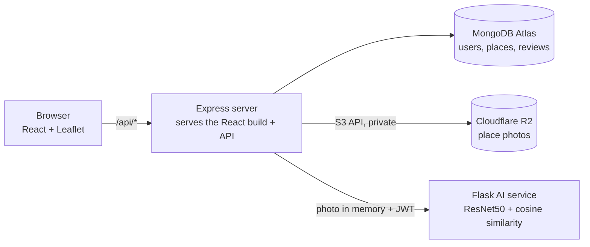

# 2Syria: development guide

Everything needed to run, load data into, and deploy 2Syria. For a short overview of the project, see the [README](README.md).

**Live demo:** https://twosyria.onrender.com

> **Try it without signing up:** open the live demo and tap one of the demo accounts on the login page. The form fills itself in, then you press **Log in**.
> The app runs on Render's free plan, so the first request after a quiet period can take up to a minute while the server wakes up.

---

## About

2Syria collects **661 places** across **13 Syrian cities** (historical sites, old ruins, religious places, great views, restaurants and hotels) and puts them on one interactive map with about **3,900 photos** and visitor reviews.

You can find a place by searching, by filtering on city, type and distance, or by uploading a photo. A ResNet50 model compares your photo with the photos of every place and shows the closest matches.

The project has three parts in one repository:

| Folder | What it is |
| --- | --- |
| [`browser/`](browser) | React 18 + Vite frontend: map, search, place panel, reviews, auth pages |
| [`server/`](server) | Node.js / Express API. It also serves the built frontend, so the whole app is one web service |
| [`2syria-flask-server/`](2syria-flask-server) | Flask AI service that does the image similarity search (TensorFlow ResNet50) |

## Features

**Explore**
- Interactive Leaflet map with custom pins; the selected place is highlighted
- Search by name, filter by **city** and **type**, or show places **within a radius** of your location (km or miles)
- Place panel with a photo slider, star rating and reviews
- Location permission asked through an in-app card instead of a browser pop-up. You decide once, and the choice is remembered

**Search by photo**
- Upload a photo from your device, or pick one from a built-in gallery of sample images
- The photo goes from the browser to the Express server and on to the AI service **in memory**. It is never written to disk
- If the AI service is down or asleep, the app shows a clear "not available right now" message instead of failing

**Accounts and reviews**
- Sign up and log in with JWT; passwords are hashed with bcrypt
- **Demo accounts** on the login page: one tap fills in the form
- Password recovery by email: a code that expires after 2 minutes, can be used once, and can't be re-requested for 30 seconds
- One review per user per place per week; the place's average rating is recalculated on every review

**Design**
- Light and dark mode with a circular reveal animation when you switch
- Responsive layout for mobile and desktop, subtle entrance animations, and support for `prefers-reduced-motion`
- [Privacy policy](https://twosyria.onrender.com/privacy) inside the app

## How it works



- **One service.** `npm run build` builds the React app into `browser/dist`, and Express serves it next to the API. Any route that isn't `/api` falls back to `index.html`, so client-side routes like `/map` work on refresh.
- **Private photo storage.** Photos live in a private Cloudflare R2 bucket under `places/<place_id>/<photo_reference>.jpg`. The browser never talks to R2. It requests `/api/place/image`, and the server streams the photo with caching headers (`ETag`, 7-day `Cache-Control`). Without R2 settings, the server falls back to `server/data/images` for local development.
- **Photo search.**
  1. The browser posts the image to `/api/place/search-by-image`.
  2. Express receives it with multer's memory storage and forwards the buffer to Flask. The request carries a service JWT (`SERVER_TOKEN`).
  3. Flask extracts ResNet50 (ImageNet) features. It compares them with the cached features of every place photo (`features.pkl`) using cosine similarity, and returns up to 20 photos scoring above 0.6, best match first.
  4. Express maps those photos back to places and returns each place once.
- **Resilient startup.** The server keeps retrying the database connection with backoff. Until the connection is ready, API calls get a fast `503` instead of hanging. `GET /api/health` reports the status.

## Tech stack

| Layer | Tools |
| --- | --- |
| Frontend | React 18, Vite 4, React Router 6, Tailwind CSS 3.3, Leaflet / react-leaflet, lucide-react, Axios |
| Backend | Node.js 22, Express 4, Mongoose 7, JSON Web Tokens, bcryptjs, multer, Nodemailer, AWS SDK v3 (S3 client for R2) |
| AI service | Python 3.11, Flask 2.2, flask-jwt-extended, TensorFlow 2.14 (ResNet50), scikit-learn, Pillow |
| Data and hosting | MongoDB Atlas, Cloudflare R2, Render |

## Project structure

```text
2syria/
├── browser/                     # React frontend
│   ├── public/                  # favicon, logo
│   └── src/
│       ├── api/api.js           # all calls to the server
│       ├── assets/search-images # sample photos for the "search by photo" gallery
│       ├── components/          # Brand, ImageSearch, ImagesSlider, SearchForm, ThemeToggle, ...
│       └── pages/               # Login, Signup, Map, RecoverAccount, ResetPassword, Privacy
├── server/                      # Express API (also serves browser/dist)
│   ├── controllers/  middleware/  models/  routes/
│   ├── utils/                   # mongoUrl.js, r2.js, demo.js
│   ├── tools/                   # data scripts: import places, upload photos, check R2, seed demo data
│   ├── example.env
│   └── index.js
├── 2syria-flask-server/         # AI image similarity service
│   ├── server.py  similarities.py  requirements.txt  Procfile  example.env
├── docs/                        # demo video and GIF used in the README
├── package.json                 # root scripts: build, start, dev:server, dev:client
├── render.yaml                  # Render blueprint
└── DEPLOY.md                    # step-by-step deployment notes
```

## Getting started

### Prerequisites

- **Node.js 22** (pinned in `.node-version` and `engines`. Node 26 breaks `jsonwebtoken`'s dependencies)
- **MongoDB**: a free [MongoDB Atlas](https://www.mongodb.com/atlas) cluster, or a local / Docker instance
- *Optional:* a Cloudflare R2 bucket for photos, a Gmail App Password for recovery emails, and Python 3.11 for the AI service

### 1. Clone and configure

```bash
git clone https://github.com/sami000khaleel/2syria.git
cd 2syria
cp server/example.env server/.env      # then fill in the values (see below)
```

### 2. Run in development

Run the API and the Vite dev server in two terminals. Vite proxies `/api` to `http://localhost:3000`.

```bash
npm install --prefix server && npm install --prefix browser

npm run dev:server     # Express on http://localhost:3000 (nodemon)
npm run dev:client     # React on  http://localhost:5173
```

### 3. Run as in production

```bash
npm run build          # installs both apps and builds browser/dist
npm start              # http://localhost:3000 serves the app and the API
```

## Loading the data

All scripts run from the `server/` folder and read `server/.env`. Each one supports `--dry` to preview without changing anything, and each is safe to run again.

```bash
cd server

npm run upload-images                  # data/images/<place_id>/*.jpg  ->  R2 places/<place_id>/ (skips existing)
npm run check-r2                       # what is in the bucket, and how it compares with the local photos
npm run import-places                  # places.json -> MongoDB (matched by place_id, photos taken from R2)
npm run import-places -- --file=path/to/places.json
npm run seed                           # demo users + reviews written to fit each place type
npm run seed:clean                     # remove all demo users and their reviews
```

The demo accounts on the login page are the users created by `npm run seed` (their emails end in `@seed.2syria.test`). To hide them, set `DEMO_ACCOUNTS=false`.

## The AI service

```bash
cd 2syria-flask-server
python -m venv .venv && source .venv/bin/activate     # Windows: .venv\Scripts\activate
pip install -r requirements.txt
cp example.env .env                                    # set SERVER_TOKEN_SECRET
python server.py                                       # http://127.0.0.1:5000
```

On its first request, the service computes ResNet50 features for every photo in `../server/data/images` and caches them in `features.pkl`. Later requests only process the uploaded photo.

To connect it, point the Node server at it and give the server a token signed with the same secret:

```bash
# in server/.env
SIMILARITY_URL=http://127.0.0.1:5000/api/models/get-similarities
SERVER_TOKEN=<output of the command below>

node -e "console.log(require('jsonwebtoken').sign({sub:'2syria-server',type:'access'}, 'SAME_SECRET_AS_AI_SERVICE'))"
```

The rest of the app works without the AI service. Photo search then answers with a "not available right now" message.

## Environment variables

`server/.env` (full template with comments in [`server/example.env`](server/example.env)):

| Variable | Required | Purpose |
| --- | --- | --- |
| `PORT` | no | Port for Express (Render sets it; default `3000`) |
| `DATABASE_URL` | one DB option | A full MongoDB connection string. Takes priority over everything below |
| `MONGO_CLUSTER` | one DB option | Atlas host, e.g. `cluster0.xxxxx.mongodb.net`. The URL is built from it and the three variables below |
| `MONGO_INITDB_ROOT_USERNAME` / `MONGO_INITDB_ROOT_PASSWORD` | with Atlas or Docker | Database user |
| `MONGO_INITDB_DATABASE` | no | Database name (`2syria`) |
| `MONGO_HOST` / `MONGO_HOST_PORT` | local only | Local or Docker MongoDB (`localhost` / `27017`) |
| `JWT_SECRET` | **yes** | Signs user login tokens |
| `EMAIL`, `USER_NAME`, `APP_PASSWORD` | for recovery | Gmail account and App Password used to send recovery codes |
| `SIMILARITY_URL` | for photo search | Full URL of the Flask `/api/models/get-similarities` endpoint |
| `SERVER_TOKEN` | for photo search | JWT signed with the AI service's `SERVER_TOKEN_SECRET` |
| `AI_TIMEOUT_MS` | no | How long to wait for the AI service (default `60000`) |
| `R2_ACCOUNT_ID`, `R2_ACCESS_KEY_ID`, `R2_SECRET_ACCESS_KEY`, `R2_BUCKET` | for R2 | Private photo bucket. Leave empty to serve from `server/data/images` |
| `KEY` | no | Google Maps key, used only by `/api/place/get-place-photo` |
| `DEMO_ACCOUNTS` | no | `false` hides the demo accounts on the login page |
| `SEED_PASSWORD` | no | Password given to the seeded demo users |
| `CLIENT_DIST` | no | Path to the built frontend (default `../browser/dist`) |

`browser/.env` (optional): `VITE_API_URL` if the API isn't on the same origin (default `/api`), and `VITE_DEMO_PASSWORD` if you changed `SEED_PASSWORD`.

`2syria-flask-server/.env`: `SERVER_TOKEN_SECRET`.

> `.env` files are git-ignored. Never commit real credentials.

## API reference

All routes are under `/api`. Routes marked 🔒 need the user's JWT in a `token` header.

**Places**: `/api/place`

| Method | Route | Description |
| --- | --- | --- |
| `GET` | `/search-places` | Search and filter: `search`, `cities`, `types` (comma-separated), optional `userLat`, `userLng`, `radius`, `unit` (`km`/`mi`) |
| `GET` | `/fetch-places-nearby` 🔒 | Places within `radius` of `userLat`/`userLng` |
| `POST` | `/search-by-image` 🔒 | `multipart/form-data` with an image (max 10 MB). Returns the matching places |
| `GET` | `/image` | Streams a place photo: `placeId`, `photoReference` |
| `GET` | `/get-place-photo` | Proxies a Google Places photo by `photoReference` |

**Users**: `/api/user`

| Method | Route | Description |
| --- | --- | --- |
| `POST` | `/signup` | Create an account (`userName`, `email`, `password`) and return a token |
| `GET` | `/login` | Log in. The password is sent in a `password` header |
| `GET` | `/demo-accounts` | List the demo accounts shown on the login page |
| `POST` | `/demo-login` | Log in as a demo account |
| `GET` | `/validate-token` 🔒 | Check that a token is still valid |
| `GET` | `/send-account` 🔒 | The logged-in user's account |
| `GET` | `/recover-account` | Email a recovery code (`email`) |
| `POST` | `/recover-account` | Verify the code (`email`, `verificationCode`) and return a token |
| `PATCH` | `/reset-password` 🔒 | Set a new password |
| `POST` | `/review-place` 🔒 | Add a review (`placeId`, `review`) |
| `GET` | `/get-reviews` 🔒 | Reviews of a place (`placeId`) |

**Health**: `GET /api/health` returns the server and database status.

## Deploying on Render

The repository includes a [`render.yaml`](render.yaml) blueprint, and [`DEPLOY.md`](DEPLOY.md) has the details. In short, for a **Web Service**:

| Setting | Value |
| --- | --- |
| Root directory | *(empty, the repository root)* |
| Build command | `npm run build` |
| Start command | `npm start` |
| Health check path | `/api/health` |
| Environment | the variables above, plus `NODE_VERSION=22` |

In MongoDB Atlas, open **Network Access** and allow `0.0.0.0/0`, since Render's outgoing IPs change. The Flask service deploys as a separate Python web service (`Procfile`: `python ./server.py`). Set the Node server's `SIMILARITY_URL` to its address.

## Privacy

2Syria stores only what it needs to run accounts and reviews. For demo accounts, the only thing saved is the **date and time of the login**. Your location is used only to center the map and find nearby places, and it is never saved. If you don't share it, the app uses an approximate location from your connection. Uploaded search photos are processed in memory and never stored. See the [privacy policy](https://twosyria.onrender.com/privacy).

## Author

**Sami Khalil**: [GitHub @sami000khaleel](https://github.com/sami000khaleel)

## License

[ISC](https://opensource.org/licenses/ISC)
