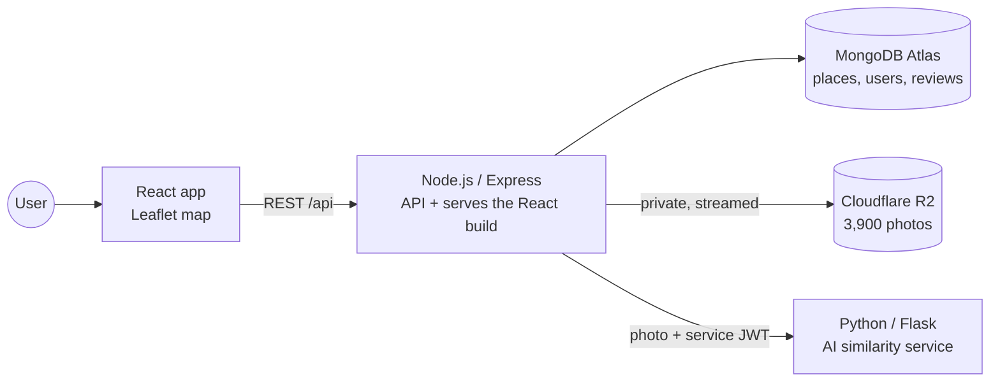
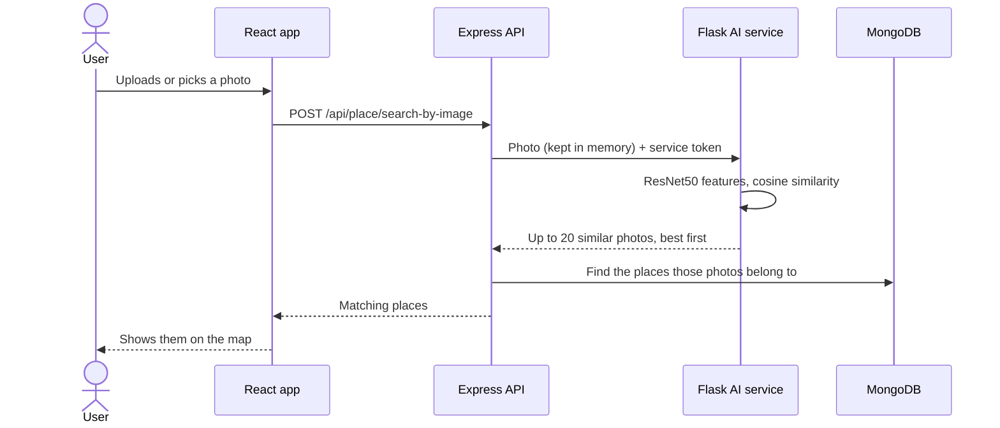

<div align="center">

# 2Syria

**Discover places across Syria on a map: search, filter, read reviews, or find a place from a single photo.**

[**Live demo**](https://twosyria.onrender.com) · [Demo video (MP4)](docs/2syria-demo.mp4) · [Development guide](DEVELOPMENT.md)


</div>

> **Try it in one click:** the login page has demo accounts, so you don't need to sign up.
> The app is on a free server, so the first visit can take up to a minute to wake it up.

## What it does

- **Map search**: 661 places in 13 cities. Search by name, or filter by city, type and distance from you.
- **Search by photo**: upload a photo or pick one from the gallery, and an AI model finds the places that look like it.
- **Reviews and ratings**: photo slider, star ratings and visitor reviews for every place.
- **Accounts**: sign-up, login, password recovery by email, and demo accounts for visitors.
- **Light and dark mode**, with a responsive layout for phones and desktops.

## Architecture



## How search by photo works



## What I built

- **A three-part system**: a React frontend, a Node.js/Express API and a Python/Flask AI service. The API and the AI service authenticate each other with JWT.
- **Image similarity search**: a pre-trained ResNet50 model turns photos into feature vectors, which are compared with cosine similarity. The features of the place photos are cached, so each search only processes the new image.
- **No temporary files**: uploaded photos travel from the browser to the AI service in memory, never written to disk.
- **Private photo storage**: about 3,900 photos sit in a private Cloudflare R2 bucket. The API streams them to the browser with caching (ETag).
- **One deployable service**: Express serves the built React app and the API together. It has a health check and reconnects to the database automatically, answering quickly with a 503 while the database is unavailable.
- **Secure accounts**: bcrypt-hashed passwords, JWT sessions, and recovery codes that expire after 2 minutes and can only be requested every 30 seconds.
- **Data tooling**: re-runnable scripts that import the places, upload photos to R2, check the bucket, and seed demo users and reviews.

## Tech stack

| | |
| --- | --- |
| **Frontend** | React 18, Vite, React Router, Tailwind CSS, Leaflet |
| **Backend** | Node.js 22, Express, MongoDB / Mongoose, JWT, bcrypt, Multer, Nodemailer |
| **AI** | Python, Flask, TensorFlow (ResNet50), scikit-learn |
| **Cloud** | MongoDB Atlas, Cloudflare R2, Render |

## Run it locally

```bash
git clone https://github.com/sami000khaleel/2syria.git
cd 2syria
cp server/example.env server/.env     # add your MongoDB connection and a JWT_SECRET
npm run build && npm start            # open http://localhost:3000
```

The [development guide](DEVELOPMENT.md) covers the full setup: loading the data, the AI service, environment variables, the API and deployment.

## Contact

**Sami Khalil**: [github.com/sami000khaleel](https://github.com/sami000khaleel)
